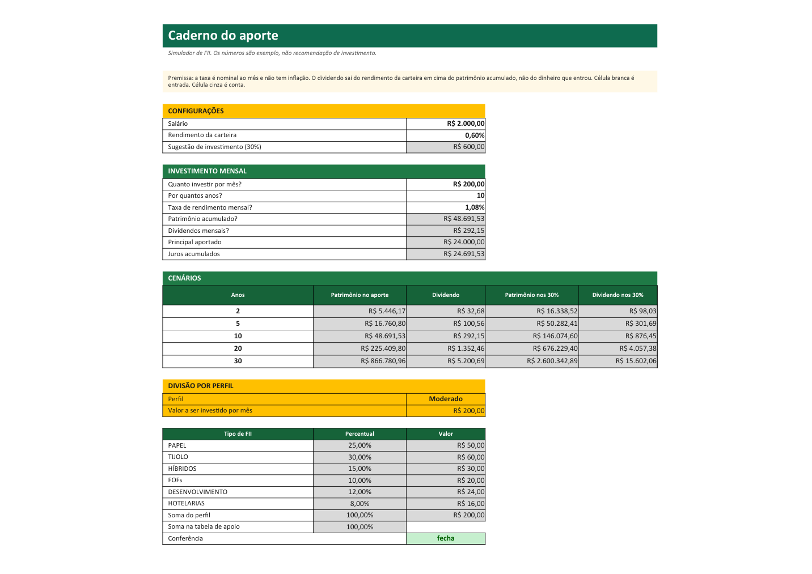

# Caderno do aporte

Planilha de estudo para simular aporte em fundo imobiliário. Abre no Excel ou no LibreOffice. Os valores são exemplo: salário de R$ 2.000, não é o meu.

Arquivo: `planilha/caderno-fii.xlsx`

## O que ela responde

Na aba **Caderno**, bloco verde **Investimento mensal**:

1. Quanto investir por mês: célula azul do aporte. No exemplo, R$ 200.
2. Por quantos anos: no exemplo, 10.
3. Taxa de rendimento mensal: no exemplo, 1,08%.
4. Patrimônio acumulado: R$ 48.691,53.
5. Dividendos mensais: R$ 292,15.

Embaixo eu separei o patrimônio em duas partes. Principal aportado é o que entrou de fato, R$ 24.000 (200 vezes 120 meses). Juros acumulados é o resto, R$ 24.691,53. Assim dá para ver o que a taxa acrescentou, em vez de olhar só o número final.

O bloco **Cenários** repete a conta para 2, 5, 10, 20 e 30 anos. A coluna da direita usa a sugestão de 30% do salário (R$ 600) com a mesma taxa, para comparar com o aporte de R$ 200.

O bloco **Divisão por perfil** reparte o aporte do mês entre seis tipos de FII. Trocar o perfil na lista muda os percentuais. A célula **Conferência** fica `fecha` quando a soma do perfil dá 100% e a soma dos valores dá o aporte.

## VF

O patrimônio usa `VF`. No arquivo a fórmula está em inglês, `FV`, que é o mesmo nome que o Excel guarda por dentro. No LibreOffice em português ela aparece como `VF`.

Os argumentos, neste caso:

- taxa: `taxa_mensal` (1,08% no exemplo)
- número de períodos: anos vezes 12
- pagamento: o aporte com sinal negativo, senão o resultado sai negativo

Não tem valor presente e não tem inflação. A taxa é nominal ao mês. O dividendo não entra nessa conta: ele é o patrimônio vezes `rendimento_carteira` (0,60% no exemplo).

## PROCV

A aba **alocacao** tem uma linha para cada par perfil + tipo. A coluna chave junta os dois com hífen, por exemplo `Moderado-TIJOLO`.

Na tela, o `PROCV` monta a mesma chave (`perfil` + hífen + tipo da linha) e busca na tabela. O quarto argumento é o percentual. Falso no final, para casar a chave inteira e não um pedaço.

## Intervalos nomeados

- `salario`
- `rendimento_carteira`
- `sugestao_investimento` (salário vezes 30%)
- `aporte`
- `qtd_anos`
- `taxa_mensal`
- `patrimonio`

Os cenários usam esses nomes. Como o nome aponta para uma célula fixa, arrastar a fórmula para os outros anos não perde a taxa nem o aporte.

## Percentuais

Eu montei a régua. Não copiei a do Felipão e não é recomendação de investimento.

A ordem é do mais previsível para o mais cíclico: papel, tijolo, híbridos, FOFs, desenvolvimento, hotelaria.

| Perfil | Papel | Tijolo | Híbridos | FOFs | Desenvolvimento | Hotelaria |
| --- | --- | --- | --- | --- | --- | --- |
| Conservador | 45% | 35% | 10% | 10% | 0% | 0% |
| Moderado | 25% | 30% | 15% | 10% | 12% | 8% |
| Agressivo | 10% | 15% | 10% | 10% | 30% | 25% |

Cada um soma 100%. Conservador fica em papel e tijolo. Agressivo joga o peso em desenvolvimento e hotelaria.

## O que mudou na ferramenta do Expert

A tela responde as mesmas perguntas, com salário, taxa e aporte de exemplo parecidos com os da aula. Mudei o resto:

- nome da ferramenta, Caderno do aporte
- a conta mostra principal e juros, não só o patrimônio
- os cenários têm uma segunda coluna com os 30% do salário
- a tabela de percentuais é outra
- tem conferência: se o perfil não fechar em 100%, ou se o valor não bater com o aporte, a célula marca `quebra`

## Prints

Mesma simulação (R$ 200 por mês, 10 anos, 1,08% ao mês) em dois perfis.

